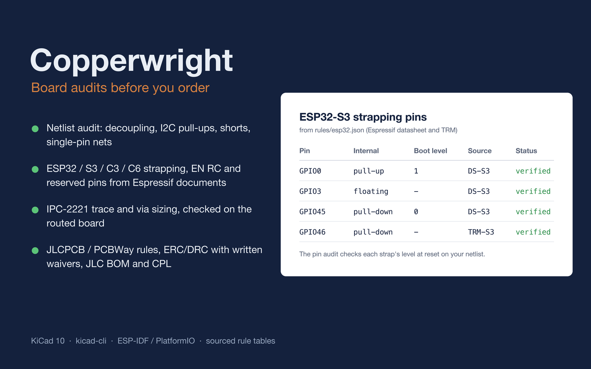
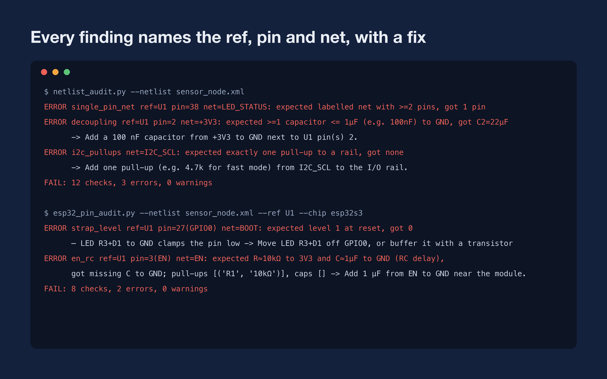
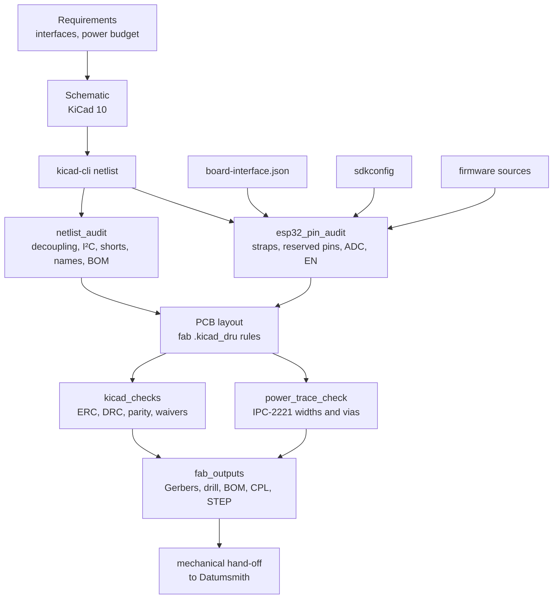
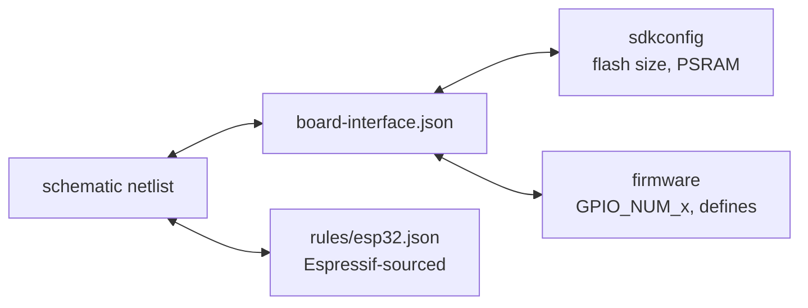
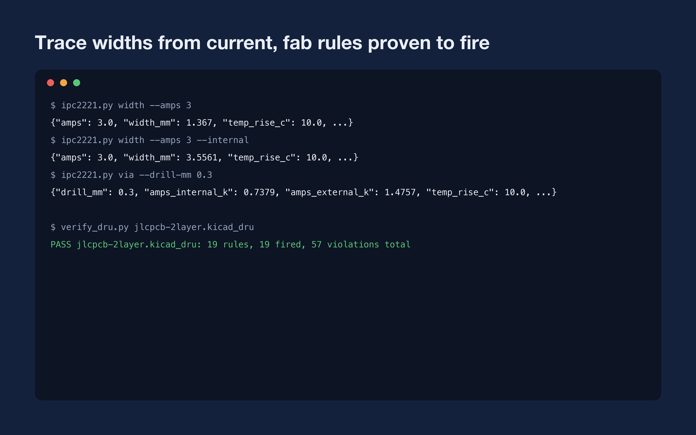

<div align="center">


# Copperwright

**An electronics skill for coding agents that audits boards before you order them.**

[English](README.md) · [Türkçe](README.tr.md)

[](https://www.agensi.io/r/SERDARVARAN?to=/skills/copperwright-kicad-esp32-board-audits-before-you-order)


<a href="https://www.agensi.io/r/SERDARVARAN?to=/skills/copperwright-kicad-esp32-board-audits-before-you-order"></a>

</div>

Copperwright teaches Claude Code, Codex CLI, Cursor and other coding agents to work on KiCad hardware
and the firmware tied to it the way a careful reviewer would. Critical electrical facts come from manufacturer
documents. Schematics, pin maps, PCB rules and fabrication files are checked by deterministic tools before a release
is called done.

> The expensive mistakes on a small board are rarely exotic: an LED on a boot strap, an EN pin with no RC, a missing
> 100 nF, a USB-C CC resistor of the wrong value. Copperwright looks for exactly those, on the netlist, not on a
> screenshot.

---

## Contents

- [What it catches](#what-it-catches)
- [How it works](#how-it-works)
- [Schematic audits](#schematic-audits)
- [ESP32 pin rules](#esp32-pin-rules)
- [PCB, power and fabrication](#pcb-power-and-fabrication)
- [Rule library](#rule-library)
- [Get Copperwright](#get-copperwright)
- [Usage](#usage)
- [Tools reference](#tools-reference)
- [What's included](#whats-included)
- [Testing and evaluation](#testing-and-evaluation)
- [Limits](#limits)
- [License](#license)

## What it catches

Real findings from the tools on an ESP32-S3 sensor board netlist with seeded defects:

<p align="center"></p>

<details>
<summary>Plain-text output</summary>

```text
$ netlist_audit.py --netlist sensor_node.xml
ERROR single_pin_net ref=U1 pin=38 net=LED_STATUS: expected labelled net with >=2 pins, got 1 pin
ERROR decoupling ref=U1 pin=2 net=+3V3: expected >=1 capacitor <= 1µF (e.g. 100nF) to GND, got C2=22µF
      -> Add a 100 nF capacitor from +3V3 to GND next to U1 pin(s) 2.
ERROR i2c_pullups net=I2C_SCL: expected exactly one pull-up to a rail, got none
      -> Add one pull-up (e.g. 4.7k for fast mode) from I2C_SCL to the I/O rail.
FAIL: 12 checks, 3 errors, 0 warnings

$ esp32_pin_audit.py --netlist sensor_node.xml --ref U1 --chip esp32s3
ERROR strap_level ref=U1 pin=27(GPIO0) net=BOOT: expected level 1 at reset, got 0
      — LED R3+D1 to GND clamps the pin low -> Move LED R3+D1 off GPIO0, or buffer it with a transistor
ERROR en_rc ref=U1 pin=3(EN) net=EN: expected R≈10kΩ to 3V3 and C≈1µF to GND (RC delay),
      got missing C to GND; pull-ups [('R1', '10kΩ')], caps [] -> Add 1 µF from EN to GND near the module.
FAIL: 8 checks, 2 errors, 0 warnings
```

</details>

On an open-source ESP32-S3 watch schematic, the same tools found the EN pin and GPIO0 wired straight to the 3V3 rail
(no reset and no auto-programming), and a CP2102N and an AMS1117 with no supply capacitors.

## How it works



Agents follow twelve non-negotiable rules in `SKILL.md`. Examples: never invent pinouts, absolute maximum ratings or
strap states; record the source of every critical value; separate verified facts, engineering choices, assumptions
and unknowns; never call a release passing without the deterministic checks.

## Schematic audits

`netlist_audit.py` reads a KiCad netlist (exported with `kicad-cli`, or directly from a `.kicad_sch`) and reports
every finding with the reference, pin, net, expected value, actual value and a fix:

| Check | What it looks for |
|---|---|
| `decoupling`, `decoupling_count` | Every IC supply pin has a small capacitor (≤ 1 µF) to ground, and enough of them |
| `bulk_capacitance` | Bulk capacitance on each supply rail |
| `i2c_pullups`, `i2c_pullup_value` | Exactly one pull-up per I²C line, sized for the bus mode and capacitance (TI SLVA689 method) |
| `power_short`, `power_out_conflict` | Supply nets tied together, two regulator outputs driving one net |
| `power_pin_unconnected`, `unconnected_pin` | Supply pins left floating or marked no-connect |
| `single_pin_net`, `net_name_collision` | Labels with one pin (usually a typo) and look-alike net names |
| `missing_mpn`, `missing_lcsc` | Parts without a manufacturer part number or JLCPCB/LCSC code |

### Pin cross-check

`esp32_pin_audit.py` keeps four sources of truth in agreement, so a pin moved in one place is caught in the others:



| Check | Meaning |
|---|---|
| `strap_level`, `strap_driven`, `strap_floating`, `invalid_strap_combo` | Boot straps get the right level at reset and no load or capacitor holds them in the wrong state |
| `reserved_flash`, `reserved_psram`, `usb_jtag_reuse` | Pins used by in-package flash, octal PSRAM (per module variant, e.g. `N16R8`) or USB-Serial/JTAG |
| `adc2_wifi`, `input_only_output` | ADC2 inputs while Wi-Fi runs; outputs on input-only pins |
| `en_rc` | EN has the pull-up and capacitor RC delay |
| `bi_pin_mismatch`, `bi_gpio_shared`, `bi_net_missing` | The pin file disagrees with the schematic |
| `sdkconfig_flash_size`, `sdkconfig_psram` | Firmware configuration disagrees with the fitted module |
| `fw_undeclared_gpio`, `fw_reserved_gpio` | Firmware touches GPIOs the pin file does not declare, or reserved ones |

## ESP32 pin rules

Generated from `rules/esp32.json`; every row is backed by Espressif datasheets, hardware design guidelines and
ESP-IDF documentation.

| Chip | Strapping GPIOs | In-package / SPI flash | Octal PSRAM | USB-Serial/JTAG | ADC1 | ADC2 (not with Wi-Fi) | Input-only |
|---|---|---|---|---|---|---|---|
| ESP32 | 0, 2, 5, 12, 15 | 6–11 | – | – | 32–39 | 0, 2, 4, 12–15, 25–27 | 34–39 |
| ESP32-S3 | 0, 3, 45, 46 | 26–32 | 33–37¹ | 19, 20 | 1–10 | 11–20 | – |
| ESP32-C3 | 2, 8, 9 | 12–17 | – | 18, 19 | 0–4 | 5 | – |
| ESP32-C6 | 4, 5, 8, 9, 15 | 24–30 | – | 12, 13 | 0–6 | – | – |

¹ Only on modules with octal PSRAM (for example `-N16R8`); `--module-variant` decides.

The research that corrected common folklore is recorded too, for example: ESP32-C6 also samples GPIO4, GPIO5 and
GPIO15; ESP32-C3 GPIO8 floats by default; ESP32-S3 GPIO3 is a strap.

## PCB, power and fabrication

- **IPC-2221 sizing.** `ipc2221.py` gives conservative widths and via counts:

  ```text
  $ ipc2221.py width --amps 3                → width_mm 1.367 (outer layer, 1 oz, ΔT 10 °C)
  $ ipc2221.py width --amps 3 --internal     → width_mm 3.556
  $ ipc2221.py via --drill-mm 0.3            → 0.74 A per via (inner-layer rule, 18 µm plating)
  ```

  `power_trace_check.py` applies the same rules to every track and via of the power nets you list in a
  `currents.json`, inside KiCad's own Python (it needs `pcbnew`).
- **Fab design rules.** Ready `.kicad_dru` files for JLCPCB 2-layer, JLCPCB 4-layer and PCBWay 2-layer.
  `kicad-cli` silently ignores a rule file with an error, so `verify_dru.py` builds a test board that violates every
  rule and proves each one fires:

  ```text
  PASS jlcpcb-2layer.kicad_dru: 19 rules, 19 fired, 57 violations total
  ```

- **ERC/DRC with waivers.** `kicad_checks.py` runs ERC, DRC and schematic parity headless. A violation can only be
  waived in a `waivers.json` entry with a written justification; GUI exclusions count as unwaived.
- **Assembly outputs.** `fab_outputs.py` writes the BOM and CPL in the fab's column format (JLCPCB by default),
  checks DNP parts and LCSC codes, applies rotation offsets, and optionally exports Gerbers, drill and STEP.
- **Renders.** `render_board.sh` produces top, bottom and isometric board images and schematic sheets for review.

<p align="center"></p>

## Rule library

Every value carries a source tag and a status; `verified` rules are errors, `disputed` and `unverified` ones only
warn (for example mains creepage and derating).

| File | Contents | Verified | Disputed | Unverified |
|---|---|---:|---:|---:|
| `esp32.json` | Straps, invalid combinations, reserved pins, ADC, power, EN RC and decoupling for ESP32, S3, C3, C6 | 55 | 0 | 1 |
| `fab_profiles.json` | JLCPCB 2-layer 1 oz, JLCPCB 4-layer, PCBWay 2-layer capabilities and assembly formats | 52 | 2 | 5 |
| `pcb.json` | IPC-2221 constants, via plating, clearances | 7 | 2 | 1 |
| `schematic.json` | Decoupling, bulk, I²C pull-up sizing, LDO and protection rules | 6 | 0 | 5 |

The skill also ships a readable summary of every table with its sources.

## Get Copperwright

Copperwright is sold on **[Agensi](https://www.agensi.io/r/SERDARVARAN?to=/skills/copperwright-kicad-esp32-board-audits-before-you-order)** as a one-time purchase. This repository is its public page: the skill
itself is not distributed here.

1. Open the [Copperwright listing](https://www.agensi.io/r/SERDARVARAN?to=/skills/copperwright-kicad-esp32-board-audits-before-you-order) and buy it.
2. Connect your agent to Agensi once (`https://mcp.agensi.io/mcp/auth`, sign-in, no API key). Claude Code, Codex CLI,
   Cursor, VS Code and other agents with remote MCP support work.
3. Ask for board work in plain language. Your agent loads the latest version of the skill every time.

Every paid Agensi skill has a 30-day money-back guarantee.

### Requirements on your machine

- An agent that can run local commands. Browser-only chat cannot run the audits.
- Python 3.11 or newer. The audit tools use the standard library only.
- [KiCad 10](https://www.kicad.org/) for `kicad-cli` (netlist export, ERC/DRC, renders, fab outputs).
  The power-trace and rule-file checks run in KiCad's bundled Python because they need `pcbnew`.
- Optional: ESP-IDF or PlatformIO for firmware builds.

## Usage

- *"Review this ESP32-S3 schematic before I send it to JLCPCB."*
- *"Plan the pins for an ESP32-C6-MINI-1 board: BME280, two LEDs, a button, battery ADC, UART log, native USB."*
- *"How wide must a 3 A trace be on the outer layer, and how many 0.3 mm vias do I need?"*
- *"Add JLCPCB 4-layer design rules to this project and run DRC."*
- *"Generate the JLCPCB assembly BOM and CPL for this board."*

## Tools reference

All scripts print JSON on stdout and a human summary on stderr. Exit codes: `0` pass or warn, `1` fail, `2` input
error (`3`: kicad-cli missing or failed, where relevant).

| Script | Purpose |
|---|---|
| `netlist_audit.py` | Schematic audit (table above) |
| `esp32_pin_audit.py` | ESP32 pin, strap, sdkconfig and firmware cross-check |
| `validate_board_interface.py`, `generate_board_header.py`, `verify_board_interface_against_kicad.py` | Machine-readable pin file, validation, C header, KiCad comparison |
| `ipc2221.py`, `power_trace_check.py` | IPC-2221 widths, currents, via capacity; power-net check on the PCB |
| `kicad_checks.py`, `kicad_validate.sh` | ERC, DRC, parity with justified waivers |
| `fab_outputs.py`, `export_manufacturing` | Assembly BOM/CPL, Gerbers, drill, STEP |
| `render_board.sh` | Board and schematic images |
| `firmware_build.sh`, `create_project.sh` | ESP-IDF / PlatformIO build helpers, project scaffold |
| `validate_handoff.py` | Mechanical hand-off file for enclosures |
| `verify_dru.py` | Proves every rule in a `.kicad_dru` fires |

## What's included

| Part | Contents |
|---|---|
| `SKILL.md` | The workflow and the twelve non-negotiable rules the agent follows |
| Rule tables | Sourced rules for the ESP32 family, PCB current and clearance, fab profiles and schematics |
| References | Rule summaries with sources, datasheet workflow, schematic, PCB, firmware and safety notes |
| Scripts | 17 self-contained audits and tools: netlist, ESP32 pins, ERC/DRC, power, fab outputs, firmware helpers |
| Templates | JLCPCB 2/4-layer and PCBWay 2-layer `.kicad_dru` rule files, JLC rotation offsets |

## Testing and evaluation

The 93 tests start from correct ESP32-S3 and ESP32-C6 boards and seed one defect at a time (LED on GPIO0, pull-down
on a strap, flash pin in use, octal PSRAM pin on an `N16R8`, EN without RC, wrong pin file, ADC2 with Wi-Fi,
sdkconfig mismatch, undeclared firmware GPIO), asserting each is caught by id. The `.kicad_dru` tests run through
KiCad's Python, and the whole suite also runs against the exact scripts Agensi delivers.

The skill was also exercised end to end by Claude and Codex with the skill installed: a seeded-defect netlist review,
a review of a real open-source watch schematic, an ESP32-C6 pin plan and IPC-2221 sizing. A grader judged only the
delivered findings and files.

## Limits

Copperwright reduces mistakes; it does not certify designs.

- Rules marked `unverified` only warn. Always confirm critical values in the current datasheet and errata.
- The fab's own DRC and assembly preview are the final word; check JLCPCB rotation offsets in their preview.
- IPC-2221 is deliberately conservative; IPC-2152 or thermal simulation may allow narrower traces.
- Bring up a first article before ordering volume.

## License

Copyright 2026 Serdar Kaan Varan, VRNSoft. All rights reserved; see [LICENSE.md](LICENSE.md).

The skill is licensed to each buyer through Agensi under the
[Agensi Terms of Service](https://www.agensi.io/terms). This repository contains documentation and images only;
they may not be copied or redistributed without permission.

The Agensi links in this README are affiliate links: if you sign up through one, I earn a commission on what you buy
in your first six months, at no extra cost to you.

## Related

- [Datumsmith](https://github.com/serdarvaran/datumsmith): the mechanical companion. Parametric CAD with sourced
  DFM rules, fit checks and ISO drawings; builds enclosures from Copperwright's hand-off.
  [Get it on Agensi](https://www.agensi.io/r/SERDARVARAN?to=/skills/datumsmith-cad-that-proves-its-parts-cadquery-dfm-iso).
