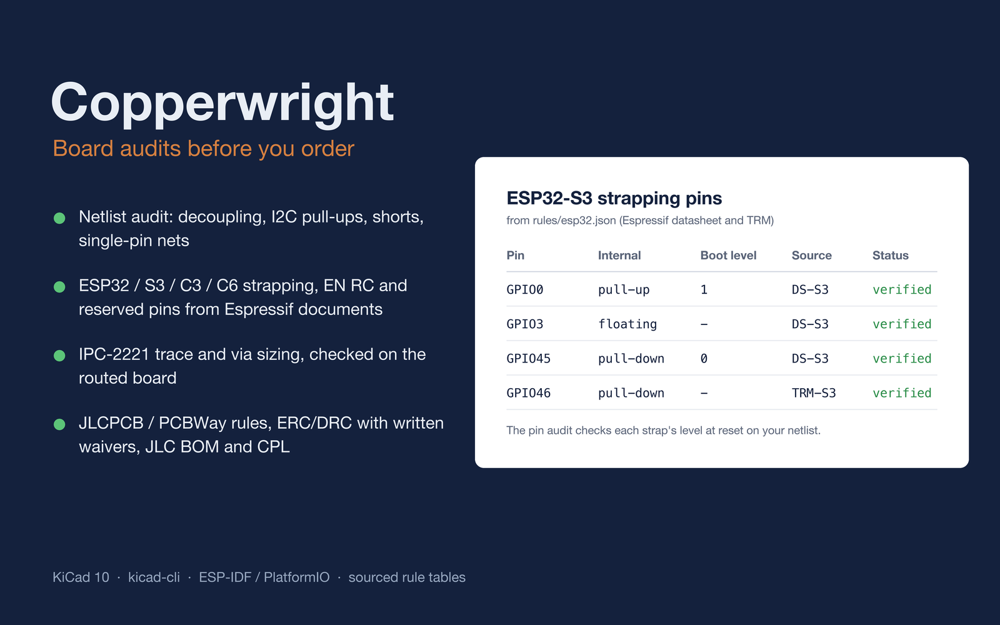
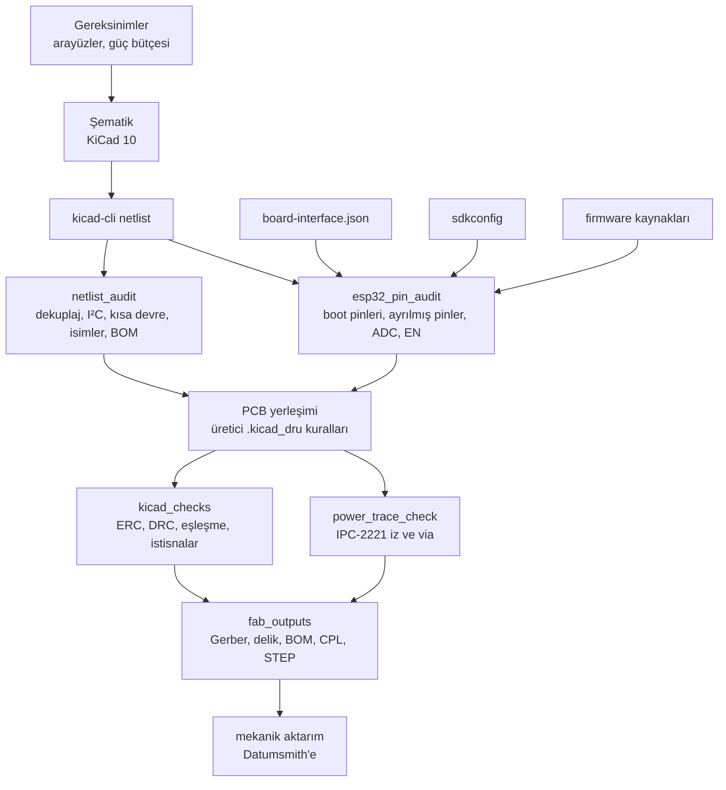
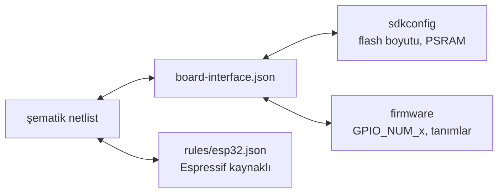

<div align="center">

# Copperwright

**Kartı sipariş etmeden önce denetleyen, kodlama ajanları için elektronik becerisi.**

[English](README.md) · [Türkçe](README.tr.md)

[](https://www.agensi.io/r/SERDARVARAN?to=/skills/copperwright-kicad-esp32-board-audits-before-you-order)




</div>

Copperwright; Claude Code, Codex CLI, Cursor ve diğer kodlama ajanlarına KiCad donanımı ve ona bağlı
firmware üzerinde titiz bir gözden geçirici gibi çalışmayı öğretir. Kritik elektriksel bilgiler üretici
belgelerinden gelir. Şematik, pin planı, PCB kuralları ve üretim dosyaları, bir sürüm "hazır" sayılmadan önce
deterministik araçlarla denetlenir.

> Küçük kartlardaki pahalı hatalar nadiren egzotiktir: boot pinine bağlı bir LED, RC'siz bir EN pini, unutulmuş bir
> 100 nF, değeri yanlış bir USB-C CC direnci. Copperwright tam olarak bunları arar; ekran görüntüsünde değil,
> netlistte.

---

## İçindekiler

- [Neleri yakalar](#neleri-yakalar)
- [Nasıl çalışır](#nasıl-çalışır)
- [Şematik denetimleri](#şematik-denetimleri)
- [ESP32 pin kuralları](#esp32-pin-kuralları)
- [PCB, güç ve üretim](#pcb-güç-ve-üretim)
- [Kural kütüphanesi](#kural-kütüphanesi)
- [Copperwright'ı edinin](#copperwrightı-edinin)
- [Kullanım](#kullanım)
- [Araçlar](#araçlar)
- [Pakette neler var](#pakette-neler-var)
- [Testler ve değerlendirme](#testler-ve-değerlendirme)
- [Sınırlar](#sınırlar)
- [Lisans](#lisans)

## Neleri yakalar

Hatalar yerleştirilmiş bir ESP32-S3 sensör kartı netlistinde araçların gerçek çıktısı:

```text
$ netlist_audit.py --netlist sensor_node.xml
ERROR single_pin_net ref=U1 pin=38 net=LED_STATUS: expected labelled net with >=2 pins, got 1 pin
ERROR decoupling ref=U1 pin=2 net=+3V3: expected >=1 capacitor <= 1µF (e.g. 100nF) to GND, got C2=22µF
      -> Add a 100 nF capacitor from +3V3 to GND next to U1 pin(s) 2.
ERROR i2c_pullups net=I2C_SCL: expected exactly one pull-up to a rail, got none
      -> Add one pull-up (e.g. 4.7k for fast mode) from I2C_SCL to the I/O rail.
FAIL: 12 checks, 3 errors, 0 warnings

$ esp32_pin_audit.py --netlist sensor_node.xml --ref U1 --chip esp32s3
ERROR strap_level ref=U1 pin=27(GPIO0) net=BOOT: expected level 1 at reset, got 0
      — LED R3+D1 to GND clamps the pin low -> Move LED R3+D1 off GPIO0, or buffer it with a transistor
ERROR en_rc ref=U1 pin=3(EN) net=EN: expected R≈10kΩ to 3V3 and C≈1µF to GND (RC delay),
      got missing C to GND; pull-ups [('R1', '10kΩ')], caps [] -> Add 1 µF from EN to GND near the module.
FAIL: 8 checks, 2 errors, 0 warnings
```

Araç çıktıları, ajanların ve araçların ortak dili olduğu için İngilizcedir; ajan sonuçları kullanıcının dilinde
raporlar.

Açık kaynaklı bir ESP32-S3 saat şematiğinde aynı araçlar şunları buldu:
- EN ve GPIO0 doğrudan 3V3 hattına bağlıydı; reset de otomatik programlama da çalışmıyordu.
- Bir CP2102N ve bir AMS1117'nin besleme kondansatörleri yoktu.

## Nasıl çalışır



Ajan `SKILL.md` içindeki on iki kesin kurala uyar. Örneğin:
- pin dizilimi, mutlak maksimum değer ya da boot durumu uydurmaz;
- her kritik değerin kaynağını kaydeder;
- doğrulanmış bilgiyi, mühendislik tercihini, varsayımı ve bilinmeyeni birbirinden ayırır;
- deterministik kontroller yapılmadan bir sürümü "geçti" saymaz.

## Şematik denetimleri

`netlist_audit.py` bir KiCad netlistini (`kicad-cli` ile dışa aktarılmış ya da doğrudan `.kicad_sch` üzerinden)
okur. Her bulguyu parça, pin, net, beklenen değer, gerçek değer ve düzeltme önerisiyle raporlar:

| Kontrol | Ne arar |
|---|---|
| `decoupling`, `decoupling_count` | Her entegre besleme pininde toprağa küçük bir kondansatör (≤ 1 µF) ve yeterli sayıda |
| `bulk_capacitance` | Her besleme hattında toplu kapasite |
| `i2c_pullups`, `i2c_pullup_value` | Her I²C hattında tam bir pull-up ve hat moduna/kapasitesine uygun değer (TI SLVA689 yöntemi) |
| `power_short`, `power_out_conflict` | Birbirine bağlanmış besleme netleri, aynı neti süren iki regülatör çıkışı |
| `power_pin_unconnected`, `unconnected_pin` | Boşta bırakılmış ya da no-connect işaretli besleme pinleri |
| `single_pin_net`, `net_name_collision` | Tek pinli etiketler (genelde yazım hatası) ve birbirine benzeyen net adları |
| `missing_mpn`, `missing_lcsc` | Üretici parça numarası ya da JLCPCB/LCSC kodu olmayan parçalar |

### Pin çapraz kontrolü

`esp32_pin_audit.py` dört doğruluk kaynağını uyumlu tutar; bir yerde değiştirilen pin diğerlerinde yakalanır:



| Kontrol | Anlamı |
|---|---|
| `strap_level`, `strap_driven`, `strap_floating`, `invalid_strap_combo` | Boot pinleri resette doğru seviyede; hiçbir yük ya da kondansatör onları yanlış durumda tutmuyor |
| `reserved_flash`, `reserved_psram`, `usb_jtag_reuse` | Dahili flash, oktal PSRAM (modül varyantına göre, ör. `N16R8`) ya da USB-Serial/JTAG pinlerinin kullanımı |
| `adc2_wifi`, `input_only_output` | Wi-Fi açıkken ADC2 girişleri; yalnız-giriş pinlerinde çıkış |
| `en_rc` | EN'de pull-up ve kondansatörle RC gecikmesi var mı |
| `bi_pin_mismatch`, `bi_gpio_shared`, `bi_net_missing` | Pin dosyası şematikle çelişiyor |
| `sdkconfig_flash_size`, `sdkconfig_psram` | Firmware yapılandırması takılı modülle çelişiyor |
| `fw_undeclared_gpio`, `fw_reserved_gpio` | Firmware pin dosyasında olmayan ya da ayrılmış GPIO'lara dokunuyor |

## ESP32 pin kuralları

`rules/esp32.json` dosyasından üretildi. Her satır Espressif veri sayfalarına, donanım tasarım kılavuzlarına ve
ESP-IDF belgelerine dayanır.

| Çip | Boot (strapping) GPIO'ları | Dahili / SPI flash | Oktal PSRAM | USB-Serial/JTAG | ADC1 | ADC2 (Wi-Fi ile kullanılamaz) | Yalnız giriş |
|---|---|---|---|---|---|---|---|
| ESP32 | 0, 2, 5, 12, 15 | 6–11 | – | – | 32–39 | 0, 2, 4, 12–15, 25–27 | 34–39 |
| ESP32-S3 | 0, 3, 45, 46 | 26–32 | 33–37¹ | 19, 20 | 1–10 | 11–20 | – |
| ESP32-C3 | 2, 8, 9 | 12–17 | – | 18, 19 | 0–4 | 5 | – |
| ESP32-C6 | 4, 5, 8, 9, 15 | 24–30 | – | 12, 13 | 0–6 | – | – |

¹ Yalnızca oktal PSRAM'li modüllerde (ör. `-N16R8`); hangisinin geçerli olduğunu `--module-variant` belirler.

Araştırma sırasında düzeltilen yaygın yanlış bilgiler de kayıtlı. Örneğin:
- ESP32-C6, GPIO4, GPIO5 ve GPIO15'i de açılışta örnekler.
- ESP32-C3'te GPIO8 varsayılanda boştadır, pull-up'lı değildir.
- ESP32-S3'te GPIO3 de bir boot pinidir.

## PCB, güç ve üretim

- **IPC-2221 boyutlandırma.** `ipc2221.py` temkinli iz genişliği ve via sayısı verir:

  ```text
  $ ipc2221.py width --amps 3                → width_mm 1.367 (dış katman, 1 oz, ΔT 10 °C)
  $ ipc2221.py width --amps 3 --internal     → width_mm 3.556
  $ ipc2221.py via --drill-mm 0.3            → via başına 0,74 A (iç katman kuralı, 18 µm kaplama)
  ```

  `power_trace_check.py` aynı kuralları, `currents.json` içinde listelediğiniz güç netlerinin her izine ve via'sına
  KiCad'in kendi Python'unda uygular (`pcbnew` gerekir).
- **Üretici tasarım kuralları.** JLCPCB 2 katman, JLCPCB 4 katman ve PCBWay 2 katman için hazır `.kicad_dru`
  dosyaları. `kicad-cli` hatalı bir kural dosyasını sessizce yok saydığı için `verify_dru.py`, her kuralı ihlal eden
  bir deneme kartı üretir ve her kuralın gerçekten tetiklendiğini kanıtlar:

  ```text
  PASS jlcpcb-2layer.kicad_dru: 19 rules, 19 fired, 57 violations total
  ```

- **İstisnalı ERC/DRC.** `kicad_checks.py`; ERC, DRC ve şematik-PCB eşleşmesini arayüzsüz çalıştırır. Bir ihlal
  ancak `waivers.json` içinde yazılı gerekçesi olan bir kayıtla istisna sayılır; arayüzde gizlenen hatalar istisna
  sayılmaz.
- **Dizgi çıktıları.** `fab_outputs.py`, BOM ve CPL dosyalarını üreticinin sütun biçiminde (varsayılan JLCPCB)
  yazar:
  - takılmayacak (DNP) parçaları ve LCSC kodlarını kontrol eder;
  - dönüş düzeltmelerini uygular;
  - isteğe bağlı olarak Gerber, delik ve STEP dosyalarını da çıkarır.
- **Görseller.** `render_board.sh`, kontrol için kartın üst, alt ve izometrik görüntülerini ve şematik sayfalarını
  üretir.

## Kural kütüphanesi

Her değerin bir kaynak etiketi ve durumu vardır. `verified` kurallar hata verir; `disputed` ve `unverified` olanlar
(örneğin şebeke gerilimi izolasyon mesafeleri ve değer düşürme) yalnızca uyarır.

| Dosya | İçerik | Doğrulanmış | Tartışmalı | Doğrulanmamış |
|---|---|---:|---:|---:|
| `esp32.json` | ESP32, S3, C3, C6 için boot pinleri, geçersiz kombinasyonlar, ayrılmış pinler, ADC, besleme, EN RC, dekuplaj | 55 | 0 | 1 |
| `fab_profiles.json` | JLCPCB 2 katman 1 oz, JLCPCB 4 katman, PCBWay 2 katman kapasiteleri ve dizgi biçimleri | 52 | 2 | 5 |
| `pcb.json` | IPC-2221 sabitleri, via kaplaması, izolasyon mesafeleri | 7 | 2 | 1 |
| `schematic.json` | Dekuplaj, toplu kapasite, I²C pull-up hesabı, LDO ve koruma kuralları | 6 | 0 | 5 |

Beceri her tablonun kaynaklarıyla birlikte okunabilir bir özetini de içerir.

## Copperwright'ı edinin

Copperwright **[Agensi](https://www.agensi.io/r/SERDARVARAN?to=/skills/copperwright-kicad-esp32-board-audits-before-you-order)** üzerinden tek seferlik satın alma ile satılır. Bu depo becerinin tanıtım sayfasıdır;
becerinin kendisi burada dağıtılmaz.

1. [Copperwright ilanını](https://www.agensi.io/r/SERDARVARAN?to=/skills/copperwright-kicad-esp32-board-audits-before-you-order) açın ve satın alın.
2. Ajanınızı Agensi'ye bir kez bağlayın (`https://mcp.agensi.io/mcp/auth`, oturum açma; API anahtarı gerekmez).
   Claude Code, Codex CLI, Cursor, VS Code ve uzak MCP destekleyen diğer ajanlar çalışır.
3. Kart işini düz bir dille isteyin. Ajanınız her seferinde becerinin en güncel sürümünü yükler.

Agensi'deki her ücretli beceride 30 günlük para iade garantisi vardır.

### Bilgisayarınızda gerekenler

- Yerel komut çalıştırabilen bir ajan. Yalnızca tarayıcıda çalışan sohbet denetimleri çalıştıramaz.
- Python 3.11 ya da üstü. Denetim araçları yalnızca standart kütüphaneyi kullanır.
- `kicad-cli` için [KiCad 10](https://www.kicad.org/): netlist dışa aktarma, ERC/DRC, görsel ve üretim çıktıları.
  Güç izi ve kural dosyası kontrolleri `pcbnew` gerektirdiği için KiCad'in kendi Python'unda çalışır.
- İsteğe bağlı: firmware derlemeleri için ESP-IDF ya da PlatformIO.

## Kullanım

- *"Bu ESP32-S3 şematiğini JLCPCB'ye göndermeden önce gözden geçir."*
- *"ESP32-C6-MINI-1 kartı için pin planı çıkar: BME280, iki LED, bir buton, pil ADC'si, UART log, dahili USB."*
- *"3 A'lik hat dış katmanda ne kadar geniş olmalı, kaç tane 0,3 mm via gerekir?"*
- *"Bu projeye JLCPCB 4 katman kurallarını ekle ve DRC çalıştır."*
- *"Bu kart için JLCPCB dizgi BOM ve CPL dosyalarını üret."*

## Araçlar

Tüm betikler stdout'a JSON, stderr'e okunabilir özet yazar. Çıkış kodları: `0` geçti ya da uyarı, `1` kaldı, `2`
girdi hatası (ilgili araçlarda `3`: kicad-cli yok ya da hata verdi).

| Betik | Görevi |
|---|---|
| `netlist_audit.py` | Şematik denetimi (yukarıdaki tablo) |
| `esp32_pin_audit.py` | ESP32 pin, boot, sdkconfig ve firmware çapraz kontrolü |
| `validate_board_interface.py`, `generate_board_header.py`, `verify_board_interface_against_kicad.py` | Makinece okunur pin dosyası, doğrulama, C başlık dosyası, KiCad karşılaştırması |
| `ipc2221.py`, `power_trace_check.py` | IPC-2221 iz genişliği, akım, via kapasitesi; PCB'de güç neti kontrolü |
| `kicad_checks.py`, `kicad_validate.sh` | Gerekçeli istisnalarla ERC, DRC ve eşleşme |
| `fab_outputs.py`, `export_manufacturing` | Dizgi BOM/CPL, Gerber, delik, STEP |
| `render_board.sh` | Kart ve şematik görselleri |
| `firmware_build.sh`, `create_project.sh` | ESP-IDF / PlatformIO derleme yardımcıları, proje iskeleti |
| `validate_handoff.py` | Kutu tasarımı için mekanik aktarım dosyası |
| `verify_dru.py` | Bir `.kicad_dru` içindeki her kuralın tetiklendiğini kanıtlar |

## Pakette neler var

| Bölüm | İçerik |
|---|---|
| `SKILL.md` | Ajanın izlediği iş akışı ve on iki kesin kural |
| Kural tabloları | ESP32 ailesi, PCB akım ve izolasyon, üretici profilleri ve şematik için kaynaklı kurallar |
| Referanslar | Kaynaklı kural özetleri, veri sayfası iş akışı, şematik, PCB, firmware ve güvenlik notları |
| Betikler | Kendi başına çalışan 17 denetim ve araç: netlist, ESP32 pinleri, ERC/DRC, güç, üretim çıktıları, firmware yardımcıları |
| Şablonlar | JLCPCB 2/4 katman ve PCBWay 2 katman `.kicad_dru` kural dosyaları, JLC dönüş düzeltmeleri |

## Testler ve değerlendirme

93 test, doğru tasarlanmış ESP32-S3 ve ESP32-C6 kartlarından başlar ve her seferinde bir hata yerleştirir. Testler
her hatanın kendi kontrol adıyla yakalandığını doğrular. Yerleştirilen hatalar:
- GPIO0'a bağlı LED;
- bir boot pininde pull-down;
- kullanılmış flash pini;
- `N16R8` üzerinde oktal PSRAM pini;
- RC'siz EN;
- yanlış pin dosyası;
- Wi-Fi ile birlikte ADC2;
- sdkconfig uyuşmazlığı;
- tanımsız firmware GPIO'su.

`.kicad_dru` testleri KiCad'in Python'uyla çalışır. Tüm test takımı Agensi'nin teslim ettiği betiklerin kendisine
karşı da çalıştırılır.

Beceri ayrıca, kurulu olduğu Claude ve Codex tarafından baştan sona çalıştırılan gerçek görevlerle sınandı:
- hatalar yerleştirilmiş bir netlistin incelenmesi;
- açık kaynaklı gerçek bir saat şematiğinin incelenmesi;
- bir ESP32-C6 pin planı;
- IPC-2221 hesabı.

Puanlayıcı yalnızca teslim edilen bulgulara ve dosyalara baktı.

## Sınırlar

Copperwright hataları azaltır; tasarımları sertifikalandırmaz.

- `unverified` işaretli kurallar yalnızca uyarır. Kritik değerleri her zaman güncel veri sayfasında ve errata'da
  doğrulayın.
- Son söz üreticinin kendi DRC'si ve dizgi önizlemesidir; JLCPCB dönüş düzeltmelerini onların önizlemesinde kontrol
  edin.
- IPC-2221 bilerek temkinlidir; IPC-2152 ya da termal simülasyon daha dar izlere izin verebilir.
- Seri sipariş vermeden önce ilk kartı çalıştırıp deneyin.

## Lisans

Telif hakkı 2026 Serdar Kaan Varan, VRNSoft. Tüm hakları saklıdır; bkz. [LICENSE.md](LICENSE.md).

Beceri her alıcıya Agensi üzerinden [Agensi Kullanım Koşulları](https://www.agensi.io/terms) kapsamında lisanslanır.
Bu depo yalnızca dokümantasyon ve görsel içerir; izin alınmadan kopyalanamaz ya da dağıtılamaz.

Bu README'deki Agensi linkleri ortaklık (affiliate) linkleridir: bunlardan biriyle kayıt olursanız ilk altı ayda
yaptığınız alımlardan komisyon kazanırım. Size ek bir maliyeti yoktur.

## İlgili proje

- [Datumsmith](https://github.com/serdarvaran/datumsmith): mekanik taraftaki eşi. Kaynaklı DFM kuralları, montaj
  kontrolleri ve ISO teknik resimle parametrik CAD; kutuları Copperwright'ın aktarım dosyasından üretir.
  [Agensi'den edinin](https://www.agensi.io/r/SERDARVARAN?to=/skills/datumsmith-cad-that-proves-its-parts-cadquery-dfm-iso).
